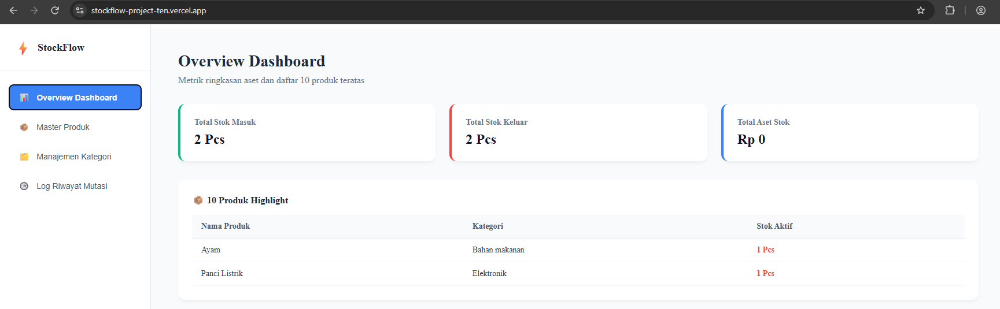
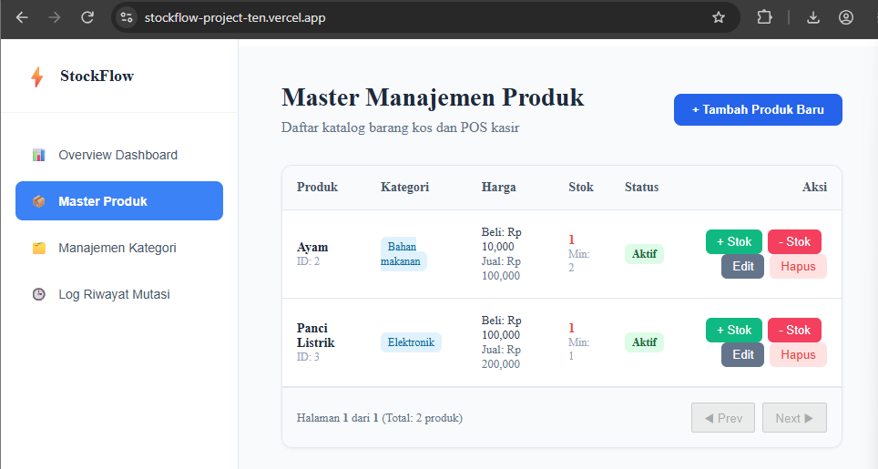
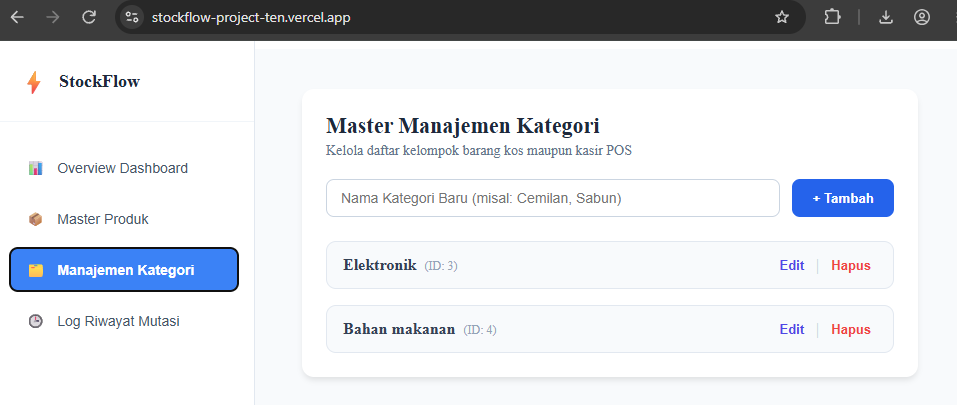
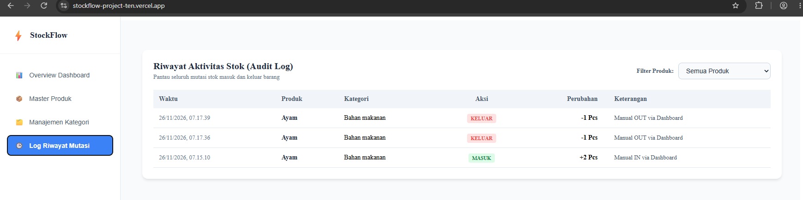
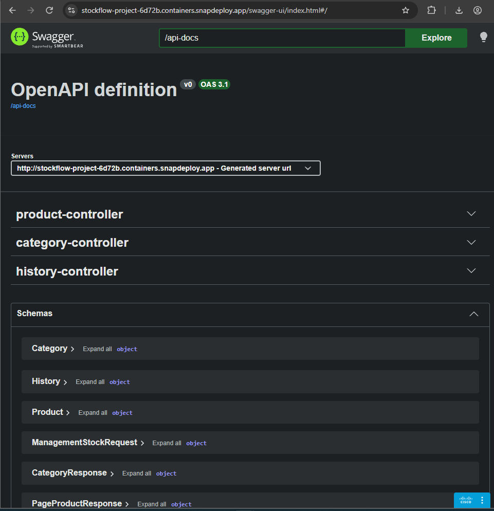
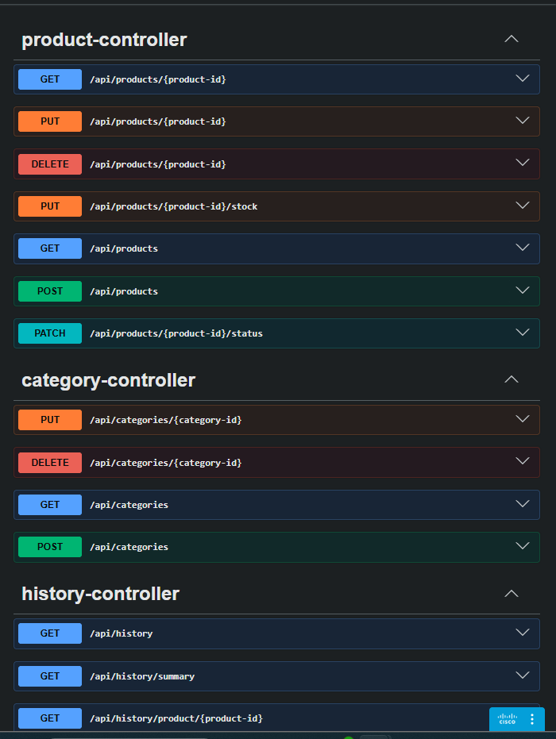
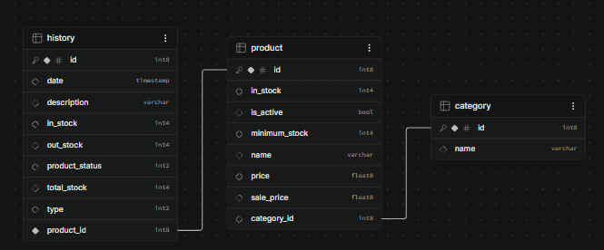

# ⚡ StockFlow — Inventory & Stock Management System

**StockFlow** adalah aplikasi web *full-stack* untuk manajemen inventori, pemantauan stok barang, serta pencatatan riwayat mutasi keluar-masuk barang secara *real-time*. Aplikasi ini dirancang dengan antarmuka modern berbasis **Side Panel Navigation** untuk memudahkan pengelolaan stok barang usaha maupun kasir (POS).

🌐 **Live Demo:** [stockflow-project-ten.vercel.app](https://vercel.app)  
📖 **API Documentation (Swagger UI):** [Swagger OpenAPI](https://snapdeploy.app)

---

## 🖼️ Tampilan Aplikasi & Skema Database

### 1. Overview Dashboard
Menampilkan ringkasan total stok masuk, total stok keluar, valuasi aset stok, serta 10 produk teratas dengan indikator peringatan stok minimum.


### 2. Master Manajemen Produk
Pengelolaan katalog produk lengkap (CRUD), aksi cepat mutasi stok (`+ Stok` / `- Stok`), status produk (`Aktif` / `Non-Aktif`), serta paginasi data.


### 3. Master Manajemen Kategori
Pengelolaan kelompok kategori barang untuk pengorganisasian produk.


### 4. Log Riwayat Mutasi (Audit Trail)
Pencatatan lengkap setiap transaksi stok masuk (`MASUK`) dan keluar (`KELUAR`) dengan fitur filter berdasarkan produk.


### 5. Dokumentasi API (Swagger UI) & Skema Database (ERD)
Dokumentasi interaktif REST API menggunakan **Springdoc OpenAPI / Swagger** serta relasi tabel PostgreSQL (`category`, `product`, dan `history`) di **Supabase**.

| Swagger UI (OpenAPI 3.1) | Swagger UI API(OpenAPI 3.1)| Database Schema (Supabase ERD) |
| :---: | :---: |
|  |  |  |

---

## ✨ Fitur Utama

* **📊 Overview Dashboard:** Metrik ringkasan stok masuk/keluar, total aset, dan tabel *highlight* 10 produk teratas dengan *low-stock alert*.
* **📦 Master Manajemen Produk:** Tambah, edit, hapus produk, pengaturan harga beli/jual, mutasi stok instan (`+ Stok` / `- Stok`), kontrol status aktif, dan *Server-Side Pagination* (Spring Data JPA `Pageable`).
* **🗂️ Master Manajemen Kategori:** Tambah, edit *inline*, dan hapus kategori barang.
* **🕒 Log Riwayat Mutasi (Audit Log):** Pelacakan riwayat perubahan stok lengkap dengan waktu transaksi, keterangan, dan filter per produk.
* **📑 Interaktif API Docs:** Dokumentasi *endpoint* terintegrasi menggunakan Swagger UI.

---

## 🛠️ Teknologi & Arsitektur Deployment

### Tech Stack
* **Frontend:** React, TypeScript (Vite), Axios
* **Backend:** Java 17+, Spring Boot, Spring Data JPA (Hibernate), Lombok, Springdoc OpenAPI (Swagger UI)
* **Database:** PostgreSQL

### Infrastruktur Cloud (Production)

| Layer | Layanan Cloud | URL / Keterangan |
| :--- | :--- | :--- |
| **Database** | **Supabase** | Managed PostgreSQL Database (`category`, `product`, `history`). |
| **Backend API** | **Snapdeploy** | Containerized Spring Boot REST API (`stockflow-project-6d72b.containers.snapdeploy.app`). |
| **Frontend Web** | **Vercel** | Hosting aplikasi SPA React + TypeScript (`stockflow-project-ten.vercel.app`). |

---

## 📂 Struktur Proyek

### 1. Backend (`backend/`)
```text
backend/
├── config/
│   └── CorsConfig.java             # Konfigurasi CORS untuk akses dari frontend
└── src/main/
    ├── java/com/hendra/stockflow/backend/
    │   ├── controller/             # REST API Endpoints (Product, Category, History)
    │   ├── exception/              # Custom Exception & Global Error Handling
    │   ├── model/
    │   │   ├── dto/                # Data Transfer Objects (Request & Flat Response)
    │   │   ├── entity/             # Entitas JPA Database (Product, Category, History)
    │   │   └── enums/              # Enum status & tipe mutasi (ProductStatus, HistoryType)
    │   ├── repository/             # Spring Data JPA Repositories & Pagination
    │   ├── service/                # Logika bisnis & kalkulasi mutasi stok
    │   └── BackendApplication.java # Main entry point aplikasi Spring Boot
    └── resources/
        └── application.properties  # Konfigurasi database Supabase, JPA & port server
```

### 2. Frontend (`frontend/src/`)
```text
src/
├── api/
│   └── productApi.ts           # Konfigurasi Axios & endpoint API (Products, Categories, History)
├── components/
│   ├── Sidebar.tsx             # Navigasi panel samping (Side Panel)
│   ├── OverviewDashboard.tsx   # Halaman ringkasan aset & 10 produk highlight
│   ├── ProductDashboard.tsx    # Halaman master CRUD produk, mutasi stok & paginasi
│   ├── CategoryManager.tsx     # Halaman pengelolaan master kategori
│   └── HistoryLogs.tsx         # Halaman audit log riwayat mutasi barang
├── types/
│   └── index.ts                # Definisi TypeScript interfaces & DTO responses
└── App.tsx                     # Root layout pengatur navigasi antar tab
```

---

## 🚀 Cara Menjalankan Proyek Secara Lokal

### Prasyarat
* **Node.js** (v18 atau lebih baru) & **npm**
* **Java JDK** (v17 atau lebih baru) & **Maven**
* **PostgreSQL** (Lokal atau koneksi langsung ke **Supabase**)

### 1. Menjalankan Backend (Spring Boot)
1. Masuk ke direktori `backend/`.
2. Konfigurasikan koneksi database dan port di `src/main/resources/application.properties`:
   ```properties
   server.port=\${PORT:8080}
   spring.datasource.url=jdbc:postgresql://localhost:5432/stockflow_db
   spring.datasource.username=your_username
   spring.datasource.password=your_password
   spring.jpa.hibernate.ddl-auto=update
   ```
3. Jalankan aplikasi Spring Boot:
   ```bash
   ./mvnw spring-boot:run
   ```

### 2. Menjalankan Frontend (React + Vite)
1. Masuk ke direktori frontend proyek Anda.
2. Instal seluruh dependensi:
   ```bash
   npm install
   ```
3. Pastikan URL dasar API di `src/api/productApi.ts` mengarah ke server backend Anda (lokal `http://localhost:8080/api` atau URL produksi **Snapdeploy**).
4. Jalankan server pengembangan:
   ```bash
   npm run dev
   ```
5. Buka browser dan akses `http://localhost:5173`.

---

## 🗺️ Roadmap Pengembangan Selanjutnya

- [ ] **Autentikasi & Otorisasi User:** Implementasi **Spring Security + JWT (JSON Web Token)** untuk membatasi akses sistem (halaman *Login*, proteksi endpoint API, serta manajemen peran *Admin* & *Kasir*).
- [ ] **Pencarian & Filter Lanjutan:** Fitur *search bar* produk dan filter berdasarkan kategori pada tabel master produk.
- [ ] **Export Laporan:** Fitur unduh laporan stok dan riwayat mutasi ke format Excel/PDF.

---

## 👤 Kontributor

* **Hendra Siswanto** — [GitHub Profile](https://github.com)
